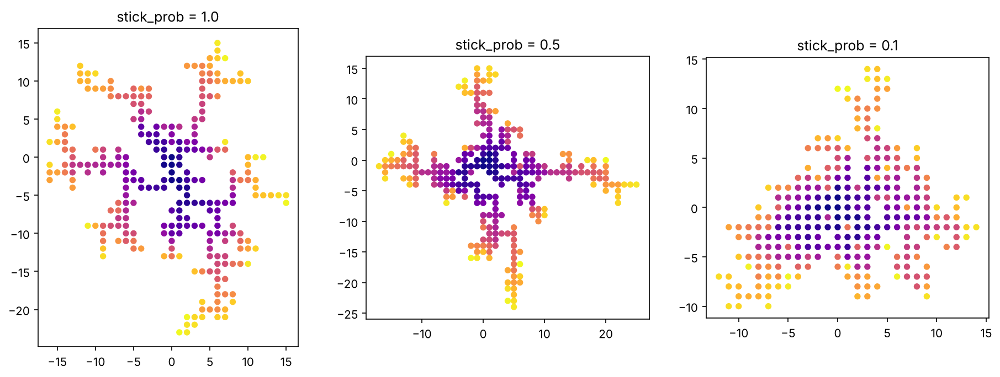
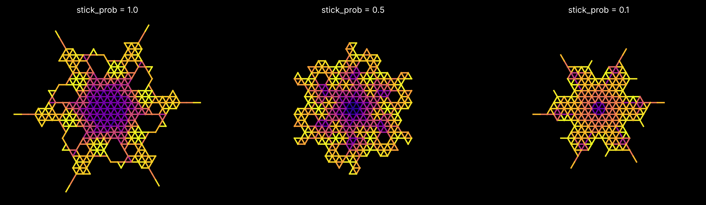
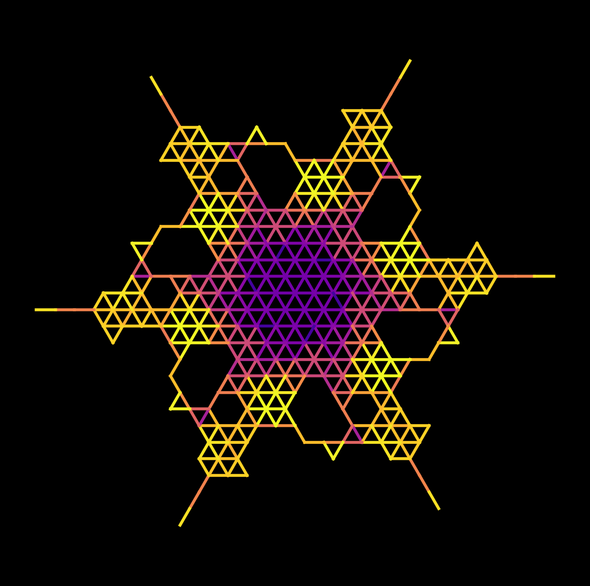

# How-does-sticking-probability-effect-the-structure of a DLA cluster?
# Overview 
Diffusion-limited aggregation (DLA) is a computational model that represents noisy growth that is limited by diffusion in a random environment.  The idea behind the mechanism is a simple one. You start with a random nucleation center, with a single particle of a certain radius, let’s say R, placed at the center. This is followed by the release of a second particle at a random point some distance away. The newly released particle is allowed to diffuse in a random direction until it happens to be within a radius R of the first particle. At the point of contact, the second particle is allowed to aggregate with the first particle in the center. Then a second walker (a different name for a particle) is added at a random position and allowed to diffuse until it is within the radius of either the first walker or the second, and it is allowed to aggregate, and so on. A DLA cluster is then formed because of the addition of N-1 particles to the particle at the center. 

For this project, I used Python to explore how the sticking probability of a particle effect a DLA cluster. 

I used three different sticking probabilities: 

  - **1.0 - 100% sticking probability:** every particle that comes close to the cluster sticks. 

  - **0.5 - 50% sticking probability:** a particle has 50% chance of sticking once it comes closer to the cluster. 

  - **0.1- 10% sticking probability:** a particle has 10% chance of sticking once it comes closer to the cluster. 

By comparing the resulting cluster, I wanted to understand how sticking probability effects the cluster growth, branching patterns and the overall morphology. 

## Research Question 

How does sticking probability influence the growth and structure of a DLA cluster? 

## Scientific Background 

# What is Diffusion-Limited Aggregation? 

Diffusion-limited aggregation (DLA) is a computational model that represents noisy growth that is limited by diffusion in a random environment.  The idea behind the mechanism is a simple one. You start with a random nucleation center, with a single particle of a certain radius, let’s say R, placed at the center. This is followed by the release of a second particle at a random point some distance away. The newly released particle is allowed to diffuse in a random direction until it happens to be within a radius R of the first particle. At the point of contact, the second particle is allowed to aggregate with the first particle in the center. Then a second walker (a different name for a particle) is added at a random position and allowed to diffuse until it is within the radius of either the first walker or the second, and it is allowed to aggregate, and so on. A DLA cluster is then formed because of the addition of N-1 particles to the particle at the center. 

## Why do DLA Clusters Form Branches? 

One important explanation is **screening.** The idea is as follows: when a new particle is allowed to diffuse, it walks a certain distance and gets captured by another particle; do this often enough, and you get a nice branch that keeps capturing new oncoming particles. Because the branches keep “capturing” the new particles before they can diffuse deep inside, the spaces or the “Fjords” do not get filled up. Thus, we say, “the fjords are screened.” 
In his article, Sanders states that “The larger-scale structure of a DLA cluster is dominated by non-local effects.” A non-local effect, simply put, refers to the idea that something happening at one point can influence the behavior of something else happening at a different point. In the context of the DLA clusters, non-local effects are governed by screening. An incoming particle is captured by a branch and fails to reach a different area; thus, the branch that captures the particles early keeps growing while other parts of the clusters remain small. Therefore, the shape of a DLA cluster is influenced by where the next particle will attach, causing larger branches in a particular area and shorter branches elsewhere, as well as leaving the ‘fjords” unfilled. 

## What Causes the Clusters to Become Rough? 

Starting with a smooth surface does not necessarily mean the resulting cluster will be smooth. In DLA, the formation of bumps on the surface is due to **shot noise** in the arrival of the particle. Shot noise is the random fluctuations in the arrival of particles. Because of screening and shot noise, a smooth surface can lead to bumps and a rougher surface, yielding a rough cluster. How do these bumps form? They can grow because of instability, which is followed by tip-splitting. Tip splitting happens due to screening, where some growing branches can split into tips due to random fluctuations; thus, repeated splitting, growing, and branching can give rise to fractals (structures with patterns and complexity that can appear across different length scales).

## Methods 
I used Python using Google Colab. The main libraries used were: 

- randon - used for generating random particle movement and attachment
- math - for distance measurements and coordinate calculations.
- matplotlib - for visualizing the resulting clusters.

## Experiment 1: Square-Lattice DLA 

The first part of the experiment used a square lattice. Each walker (particle) could move one step up, down, left or right at a time

The process began with a single particle at the origin (0,0). New walkers were released from a random point on a circle of 5 steps outside the cluster's current edge, this allowed the launch circle to grow as the cluster grew. The walker moved randomly, one step at a time, for up to 5,000 steps. 

Once the walker was next to a particle already in the cluster, it stuck with a probability equal to the sticking probability. If the particle failed to attach, it kept walking. A walker that has not stuck after 5,000 steps was discarded. 

4OO walkers were run for each sticking probability. 

## Fractal Dimensions measurement 

I counted that particles within radius 4 and 10 of the center. I did this for 5 separate clusters per sticking probability and averaged the results. 

## Experiment 2: Hexagonal Lattice and Snowflake images. 

I also wanted to explore different shapes of the clusters. For this, I changed the lattice so that each particle has 6 neighbors instead of 4. To make snowflake-style images, I took small cluster about 140 walkers and rotated copies of it by 60 degrees six times. 

## Results 

Sticking probability comparison 

- **1.0 - 100% sticking probability:** at this sticking probability the clusters had long, thin arms reaching outwards. The clusters had empty gaps between them.
- **0.5 - 50% sticking probability:** this was a tricky one because the shape varied from run to run. Sometimes the cluster looked bulky and sometimes it had long arms similar to the 1.0 clusters.
- **0.1- 10% sticking probability:** at this sticking probability the clusters were more rounder, shorter and more filled in with very little empty gaps between them.

### Square-Lattice DLA

The following figure compares cluster morphology across the three
sticking probabilities.

### Triangular-Lattice DLA

The following figure shows cluster growth on a triangular lattice
under the same sticking probabilities.

### Color Visualization

Additional color-coded visualization of the triangular-lattice
DLA structures.

## Fractal-Dimension (5 runs per setting) 

| Sticking probability | Average D | Range of 5 runs|
|----------------------|-----------|----------------|           
| 1.0                  | 1.48      | 1.31 to 1.69   |
| 0.5                  | 1.68      | 1.42 to 1.93   |
| 0.1                  | 1.62      | 1.58 to 1.67   |

## Discussion 

- Shape of the cluster is dependent on stickiness. The difference between the shape of the three clusters indicate that stickiness does change the shape of the clusters. The 0.1 clusters were more round and more filled in compared to the 1.0 clusters. This supports the idea of screening, that sticking particles rarely reach gaps before attaching.
- The 0.1 clusters were most consistent of the three. For the 0.1 clusters the D was between 1.58 t0 1.67 for all five runs. Compared to the 1.0 and 0.5 clusters. A possible explanation could be that when a walkers sticks on first contact, early branches can take over the growth.

## Limitations 

- I only ran 5 runs per setting and the clusters are pretty small (up to 400 walkers) 
- Random particle movement can produce different structures between different runs.
- Not every walker attacked to the cluster and they were discarded after 5,000 steps.

## Conclusion 

Through this project I learned about DLA clusters, sticking probabilities, random walkers, and screening with computational model. 

## Acknowledgments 

I wrote the code step by step with the help from an AI assistant (Claude), and ran, debugged all of it myself. 

## References 

- Sander, L. M. (2000). Diffusion-limited aggregation: A kinetic critical phenomenon? Contemporary Physics, 41(4), 203-218.
- Witten, T. A., & Sander, L. M. (1981). Diffusion-limited aggregation, a kinetic critical phenomenon. Physical Review Letters, 47, 1400.

